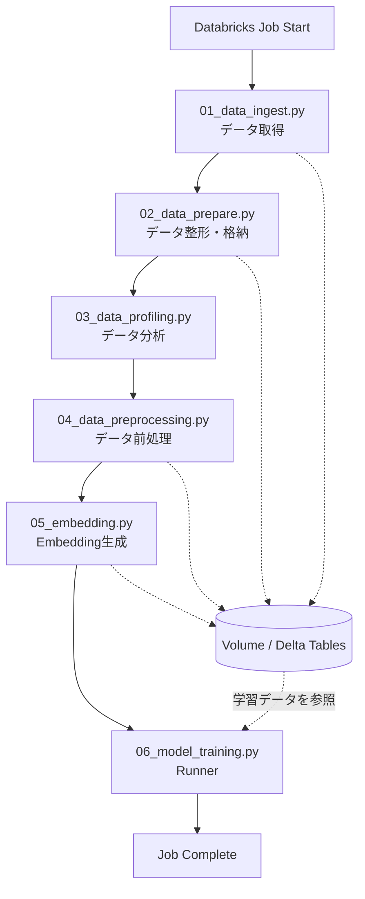
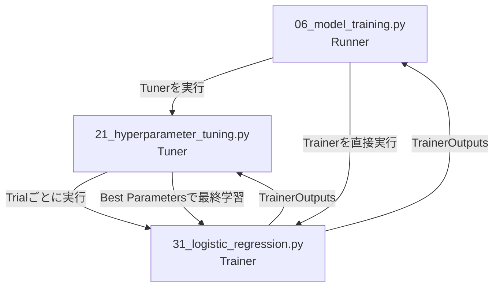
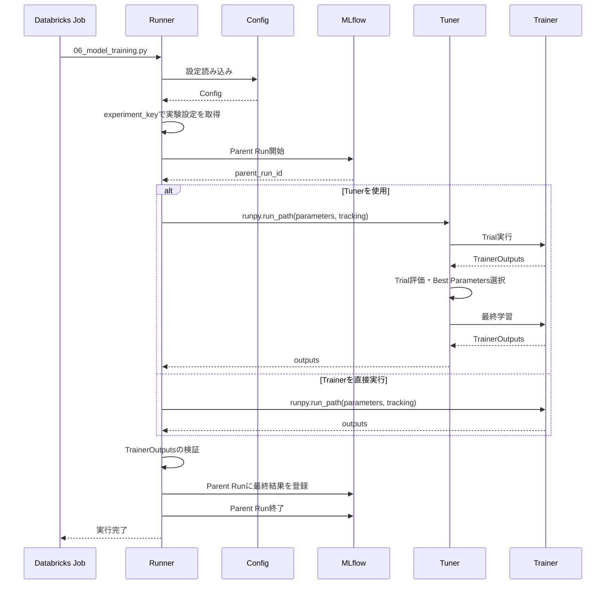
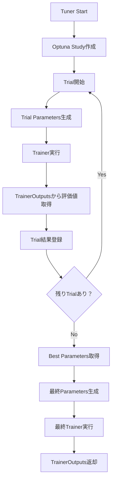
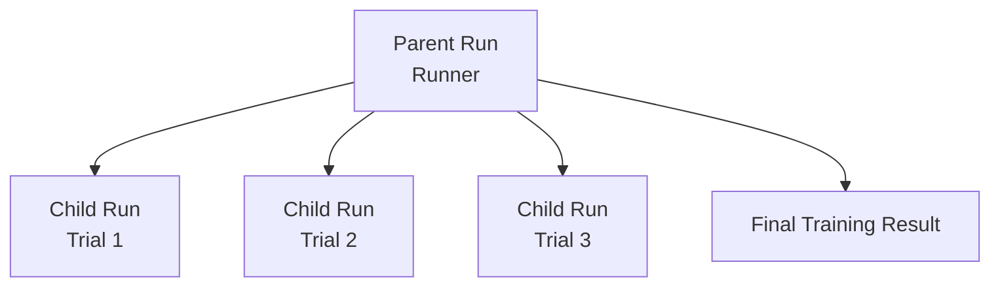
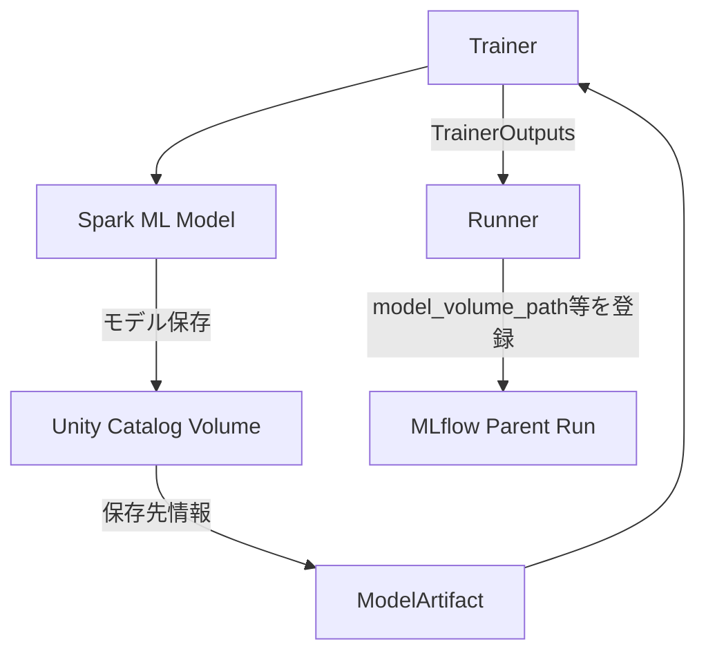

# Workflow Architecture

## 1. Overview

本システムは、データの取得から前処理、Embedding生成、モデル学習までをDatabricks Jobで実行する機械学習ワークフローである。

モデル学習部分は、Runner・Tuner・Trainerの3つの役割に分離している。

- **Runner**: 実験設定の読み込み、Parent Runの管理、学習処理の実行制御
- **Tuner**: Optunaによるハイパーパラメータ探索、Trialの管理、最適パラメータによる最終学習
- **Trainer**: モデルの学習・評価・保存、および学習結果の返却

実行制御には `runpy.run_path()` を使用し、Notebook間では `parameters` と `tracking` を入力、`outputs` を出力とする共通インターフェースを採用している。

## 2. Overall Workflow

### 2.1 Job execution flow

Databricks Jobでは、以下の順序でNotebookを実行する。



| Notebook | 役割 |
|---|---|
| `01_data_ingest.py` | 外部データの取得 |
| `02_data_prepare.py` | データの整形・格納 |
| `03_data_profiling.py` | データの分析・確認 |
| `04_data_preprocessing.py` | モデル学習用データの前処理 |
| `05_embedding.py` | Embeddingの生成 |
| `06_model_training.py` | 実験設定に基づくモデル学習の実行制御 |

各処理で生成されたデータは、必要に応じてUnity Catalog VolumeやDelta Tableなどの共有ストレージに保存する。後続処理は保存されたデータを参照する。

## 3. Model Training Architecture

### 3.1 Component responsibilities



Runnerは実験設定に応じて、TunerまたはTrainerを実行する。

- ハイパーパラメータ探索を行う場合はTunerを実行する。
- 探索が不要な場合はTrainerを直接実行する。
- TunerはTrialごとにTrainerを実行し、最適なパラメータを決定する。
- Tunerは最適パラメータを使ってTrainerを再実行し、最終的な学習結果を取得する。

TunerとTrainerはRunnerから独立したNotebookとして実装されているが、Runnerからは共通の実行インターフェースを通じて呼び出される。

### 3.2 Runner execution flow



Runnerの主な処理は以下のとおり。

1. 設定ファイルを読み込む。
2. `experiment_key` から実行対象のExperimentConfigを取得する。
3. Parent Runを開始する。
4. `TrackingConfig` に `parent_run_id` を設定する。
5. 実験設定で指定されたNotebookを `runpy.run_path()` で実行する。
6. Notebookから返された `outputs` が `TrainerOutputs` であることを検証する。
7. 最終結果をParent Runに登録する。
8. Parent Runを終了する。

処理中に例外が発生した場合は、Parent Runを `FAILED` として終了し、例外を再送出する。

### 3.3 Tuner execution flow

TunerはOptunaを使用してハイパーパラメータ探索を行う。



Trial実行時のパラメータは、共通の固定パラメータとOptunaが探索したパラメータを組み合わせて生成する。

最終学習では、以下の優先順位でパラメータを統合する。

```python
final_parameters = (
    hp_tuning_config.base_fixed_params
    | best_params
    | hp_tuning_config.best_fixed_params
)
```

同じキーが存在する場合は、右側の辞書の値が優先される。

- `base_fixed_params`: Trialと最終学習で共通して使用する固定パラメータ
- `best_params`: Optunaによって探索された最適パラメータ
- `best_fixed_params`: 最終学習時のみ適用する固定パラメータ

Trialではモデル保存を行わず、最終学習時に保存設定を適用する。

## 4. Notebook Interface

### 4.1 Input contract

RunnerからTunerまたはTrainer、TunerからTrainerへ渡す入力は、次の2つで統一する。

| Variable | Type | Description |
|---|---|---|
| `parameters` | `dict` | 学習・探索処理に必要なパラメータ |
| `tracking` | `TrackingConfig` | Trackingおよびモデル保存に関する設定 |

Notebookの実行には `runpy.run_path()` を使用する。

```python
namespace = runpy.run_path(
    notebook_path,
    init_globals={
        "parameters": parameters,
        "tracking": tracking_config,
    },
)
```

これにより、呼び出し元からNotebookへ入力値を渡すことができる。

### 4.2 Output contract

Trainerは学習結果を `TrainerOutputs` として返す。

```python
outputs = namespace.get("outputs")

if not isinstance(outputs, TrainerOutputs):
    raise TypeError(
        f"Expected TrainerOutputs, got {type(outputs).__name__}."
    )
```

`TrainerOutputs` はTrainerからRunnerまたはTunerへ返す共通の結果オブジェクトである。

データの受け渡しは次のようになる。

| Direction | Data | Method |
|---|---|---|
| Runner → Tuner | `parameters`, `tracking` | `runpy.run_path()` |
| Runner → Trainer | `parameters`, `tracking` | `runpy.run_path()` |
| Tuner → Trainer | `parameters`, `tracking` | `runpy.run_path()` |
| Trainer → Tuner | `TrainerOutputs` | `outputs` |
| Trainer → Runner | `TrainerOutputs` | `outputs` |
| Tuner → Runner | `TrainerOutputs` | `outputs` |

Notebook間の実行は同一Pythonプロセス内で行われ、`outputs` は戻り値に相当する形で呼び出し元へ返される。

## 5. Tracking Architecture

### 5.1 Databricks environment

DatabricksではMLflow Trackingを使用する。

Runの管理責務は次のように分離する。

| Component | Responsibility |
|---|---|
| Runner | Parent Runの開始・終了 |
| Tuner | TrialごとのChild Runの開始・終了 |
| Trainer | 学習結果・Metrics・Artifact情報の生成 |
| MLflowTracker | MLflowへのTracking情報登録 |

Runの階層構造は以下のとおり。



- Parent RunはRunnerが管理する。
- Child RunはTunerが管理する。
- 各Child RunにはTrialのParametersやMetricsを記録する。
- 最終学習の結果はParent Runに登録する。
- Trainer自身はRunの開始・終了を管理しない。

Trainerを直接実行する場合はParent Runのみを作成し、Child Runは作成しない。

### 5.2 Local environment

Local環境ではLoguruによるConsole Trackingを使用する。

- Parent Runを作成しない。
- Child Runを作成しない。
- Trialの開始・終了・失敗などをコンソールへ出力する。
- モデル保存は行わない。

LocalとDatabricksで学習ロジックは共通とし、Trackingの実行方式のみを環境に応じて切り替える。

## 6. Model Artifact

Spark MLモデルはUnity Catalog Volumeに保存する。

モデル保存の処理はTrainer側で行い、保存先の情報を `ModelArtifact` としてTracking結果に含める。

MLflow Parent Runにはモデルの保存先を次のTagとして登録する。

| Tag | Description |
|---|---|
| `model_volume_path` | Unity Catalog Volume上のモデル保存先 |
| `model_format` | モデル形式。Spark MLの場合は `spark_ml` |
| `model_flavor` | モデルFlavor |

モデル保存の流れは以下のとおり。



Tuner経由の場合、Trialではモデルを保存せず、最終Trainerの実行結果だけをParent Runに登録する。

現時点ではSpark MLモデルのVolume保存を対象とする。sklearnなどの非Sparkモデルに対するMLflow Flavor対応は、対象モデルを追加する段階で検討する。

## 7. Configuration Architecture

### 7.1 Configuration files

設定ファイルは `notebooks/config/` に配置する。

```text
notebooks/
└── config/
    ├── local.yml
    └── sandbox.yml
```

- `local.yml`: 共通設定およびLocal環境の基本設定
- `sandbox.yml`: Databricks環境固有の設定

OmegaConfで両方の設定をマージする。`sandbox.yml` の値が `local.yml` の値を上書きする。

```text
local.yml
    |
    v
sandbox.yml
    |
    v
Merged Config
```

### 7.2 Experiment configuration

実行するExperimentは `experiment_key` で選択する。

```yaml
experiments:
  logistic_regression:
    run: 31_logistic_regression.py
    params:
      max_itr: 30

  baseline:
    run: 21_hyperparameter_tuning.py
    params:
      trainer: 31_logistic_regression.py
      direction: maximize
      n_startup_trials: 3
      n_trials: 5
```

`experiment_key` は実験設定を識別するキーであり、MLflow Runの名前とは役割が異なる。

### 7.3 TrackingConfig

Trackingに関する設定は `TrackingConfig` で管理する。

| Field | Description |
|---|---|
| `save_model` | モデル保存の有効・無効 |
| `parent_run_id` | Parent RunのID |
| `workspace_base` | MLflow Experimentの配置先となるWorkspace上の基準パス |
| `project_name` | プロジェクト識別子 |
| `volume_base` | モデル保存先となるVolumeの基準パス |

MLflow Experimentのパスは `workspace_base` と `project_name` から生成する。

```python
experiment_path = (
    Path(workspace_base) / Path(project_name)
).as_posix()
```

複数の実験Runを同一ProjectのMLflow Experimentにまとめて管理する。

## 8. Main Components

```text
src/
└── learn_text_classification/
    ├── runners/
    │   └── model_training.py
    ├── tracking/
    │   ├── models.py
    │   └── tracking_utils.py
    ├── config_utils.py
    ├── job_utils.py
    └── logging_utils.py

notebooks/
├── 01_data_ingest.py
├── 02_data_prepare.py
├── 03_data_profiling.py
├── 04_data_preprocessing.py
├── 05_embedding.py
├── 06_model_training.py
├── 21_hyperparameter_tuning.py
├── 31_logistic_regression.py
└── config/
    ├── local.yml
    └── sandbox.yml

resources/
└── job.yml

tests/
├── test_tracking_models.py
└── test_tracking_utils.py

pyproject.toml
```

## 9. Verification Results

現在の構成に対して、以下の検証を実施済み。

### 9.1 Local validation

| Check | Result |
|---|---|
| Ruff lint | PASS |
| Ruff format | PASS |
| Pyright | PASS |
| Pytest | PASS |
| Test count | 53 passed |
| `uv build` | Completed |
| Dependency configuration | Updated and validated |

### 9.2 Databricks validation

| Check | Result |
|---|---|
| Databricks Bundle validation | PASS |
| Job configuration | Validated |
| Databricks Job execution | Successful |
| Notebook execution flow | Verified |
| MLflow Parent / Child Run | Verified |
| Spark ML model Volume save | Verified |
| Parent Run model path registration | Verified |

### 9.3 Current operational behavior

- LocalではLoguruによるConsole Trackingを使用する。
- DatabricksではMLflow Trackingを使用する。
- Databricks Jobはデータ処理からモデル学習まで順番に実行する。
- RunnerはParent Runを管理する。
- TunerはTrial単位のChild Runを管理する。
- Trainerは学習結果を `TrainerOutputs` として返す。
- Spark MLモデルはUnity Catalog Volumeに保存する。
- モデル保存先はMLflow Parent Runの `model_volume_path` に記録する。

## 10. Summary

本システムのアーキテクチャ上の主要な責務は次のように整理できる。

| Layer | Main responsibility |
|---|---|
| Databricks Job | Notebookの実行順序・依存関係の管理 |
| Data Processing | データ取得、整形、分析、前処理、Embedding生成 |
| Runner | Experiment選択、学習実行制御、Parent Run管理 |
| Tuner | ハイパーパラメータ探索、Trial管理、最終学習 |
| Trainer | モデル学習、評価、保存、結果生成 |
| Tracking | Metrics、Parameters、Artifact情報の記録 |
| Storage | データおよびモデルArtifactの保存 |

データ処理、実行制御、ハイパーパラメータ探索、モデル学習、Trackingの責務を分離し、それぞれの処理を共通の入出力契約で接続する構成としている。